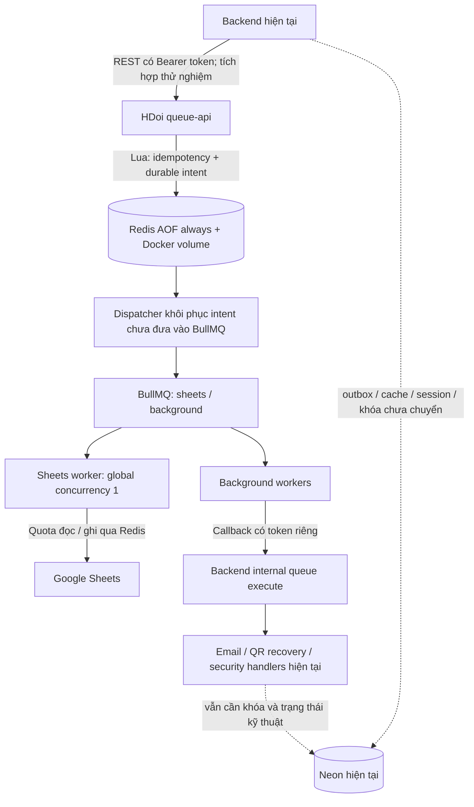

# Cập nhật runtime HDoi

**Bản bên dưới là báo cáo giai đoạn trước. Trạng thái hiện tại xem [HDOI_RUNTIME_CUTOVER.md](../docs/HDOI_RUNTIME_CUTOVER.md).** Mã runtime đã chuyển sang HDoi; chưa deploy hoặc nghiệm thu Redis/Docker thực tế.

---

# HDoi — trạng thái triển khai ngày 17/10/2026

## Kết luận hiện tại

Đã có mã nguồn Queue Service độc lập dùng Node.js, BullMQ, Redis và Docker Compose.
**Chưa hoàn tất thay thế Neon trong hệ thống chính; chưa được bật trên production.**
Không xóa job cũ, không thay đổi dữ liệu Sheets/Drive, không chạy export/import Neon
thật và không đổi các file môi trường đang sử dụng.

## Kiến trúc đã viết



- API và worker chạy riêng; worker không import backend hoặc truy vấn Neon.
- HTTP `202`, `accepted:true`, `status:waiting` chỉ xác nhận đã nhận intent vào
  Redis; **không có nghĩa dữ liệu đã ghi vào Google Sheets**.
- Intent và thứ tự entity được đăng ký qua một Lua script. Nếu API chết trước
  `Queue.add`, dispatcher tiếp tục từ Redis. ID BullMQ là SHA-256 của khóa gửi,
  giữ nguyên qua retry HTTP. Cùng khóa nhưng payload khác trả `409`.
- Hai queue tách riêng để email/QR không chiếm worker Sheets. Worker Sheets giới
  hạn đồng thời toàn cục bằng BullMQ; các job cùng entity đợi predecessor kết thúc.
  Lỗi cuối/unknown của predecessor chặn job sau, không bỏ qua lỗi để ghi dữ liệu mới.
- Bộ giới hạn đọc/ghi Redis dùng cửa sổ trượt, mặc định 40 lần/phút mỗi loại cho
  cùng namespace. Nếu nhiều deployment dùng chung Google Service Account phải
  phối hợp chung ngân sách; không bật đồng thời worker cũ và mới cho cùng nguồn.
- Retry có số lần tối đa, backoff exponential với jitter và Retry-After. Lỗi
  quyền, payload hoặc xung đột không được mặc định retry.
- Google write timeout/503 có thể đã thành công: giữ `unknown`, không tự gửi lại.
  Khi khởi động lại, ghi Sheets đang dở được đối chiếu ID/nội dung; kết quả chưa
  chắc chắn cần kiểm tra thủ công. SMTP mất ACK cũng bị giữ, không gửi lại mù quáng.
- Google Sheets không có compare-and-swap cho mọi thao tác đang dùng: chỉnh tay
  đồng thời bên ngoài hệ thống vẫn có cửa sổ race. Không cam kết exactly-once.
- Job hoàn tất/thất bại được giữ lại, không tự xóa khóa chống trùng. Cần theo dõi
  dung lượng và xây chính sách lưu trữ lịch sử trước khi chạy dài hạn.

## API nội bộ

Tất cả `/v1/*` và `/health/ready` yêu cầu `Authorization: Bearer QUEUE_API_TOKEN`.
Chỉ `/health/live` không yêu cầu token và không chứa dữ liệu.

| Đường dẫn | Chức năng |
|---|---|
| `POST /v1/jobs` | Nhận `{type,key,payload,maxAttempts,availableAt?,dependsOn?,entityKey?}` |
| `GET /v1/jobs/:id` | Trạng thái, số lần thử, trạng thái BullMQ, lịch sử kỹ thuật gần nhất; không trả payload |
| `GET /v1/jobs?offset=0&limit=20` | Danh sách trạng thái, tối đa 50 job/lượt |
| `POST /v1/jobs/by-key/retry` | Retry job failed đã biết kết quả; từ chối unknown |
| `POST /v1/jobs/:id/reconcile` | Chỉ đối chiếu lại sheet-write, yêu cầu lý do; không xóa dấu vết side effect |
| `POST /v1/jobs/by-key/resume` | Hiện trả 409: chưa có cầu nối phục hồi mail configuration tương đương hệ thống cũ |
| `GET /v1/metrics` | Số intent chờ dispatch và số job theo trạng thái mỗi queue |

`type`: `sheet-write`, `email`, `weighing-email`, `qr-recovery`, `security-alert`.
Với `sheet-write`, payload gồm `spreadsheetId`, tên sheet vật lý `sheet`,
`recordId`, `op` (`append/update/delete`), `rowValues`; cột A phải chứa ID.
Processor ghi RAW và không đổi đơn vị số. Delete clear hàng đã xác minh ID,
không dịch chuyển toàn bộ các hàng. Cần nghiệm thu tương đương nghiệp vụ trước
khi thay thế hành vi outbox cũ; chưa nối trực tiếp `baseSheetRepo` sang API mới.

## Công cụ chuyển đổi

`scripts/export-neon.cjs` dùng kết nối TLS verify-full, transaction REPEATABLE
READ READ ONLY, không bootstrap/migrate và không UPDATE/DELETE nguồn. Chỉ chạy
khi operator đã dừng ingress và tất cả worker cũ, xác nhận `--source-frozen`.
Snapshot tối đa 10.000 hàng mỗi bảng, vượt số này dừng thay vì xuất thiếu.
Chạy từ máy có dependency `backend/node_modules/pg`; đây là công cụ một lần,
không phải phụ thuộc runtime của HDoi.

```text
node HDoi/scripts/export-neon.cjs HDoi/exports/source.json --source-frozen
node HDoi/scripts/import-neon.cjs HDoi/exports/source.json HDoi/exports/target.json
```

Biến môi trường export: `DATABASE_URL`, `APP_NAMESPACE` (không ghi bí mật vào lệnh).
`target.json` chứa `{ "spreadsheetId": "...", "tabs": { "vehicles": "Tên tab thật" } }`;
phải có đủ mapping sheet logic xuất hiện trong snapshot.

Import mặc định **dry-run**, kiểm tra digest, bảo toàn số kg, nối phụ thuộc
sheet-before-email. Bất kỳ job processing/unknown/đã thử gửi hoặc mapping thiếu
đều chặn cả lần import. Chỉ sau khi xử lý hết blocker, giữ nguồn đóng và xác minh
tích hợp backend mới có thể thêm `--apply --source-frozen`; endpoint dùng
`HDOI_URL`, token `HDOI_TOKEN`. Công cụ không xóa hay đánh dấu hoàn tất job Neon.
Không chạy worker đích khi mới import để tránh side effect trước khi kiểm kê.

Snapshot chứa dữ liệu cá nhân: thư mục exports được gitignore, file tạo độc quyền,
cần mã hóa, phân quyền và xóa theo chính sách sau nghiệm thu. Chưa thử các công
cụ này trên Neon thật trong lượt triển khai này.

## Kết quả đã chạy

| Kiểm tra | Kết quả |
|---|---|
| `HDoi npm test` | 26 passed, 0 failed; facade Google/fetch được inject, không gọi dịch vụ thật |
| `HDoi npm run check` | 21 file JS/CJS hợp lệ cú pháp |
| `backend npm test` với URL DB rỗng | 348 tests: 332 passed, 16 skipped, 0 failed |
| `HDoi npm run test:integration` | 1 test Redis tích hợp bị skip vì chưa có URL Redis test riêng |
| Docker Compose / restart / kill worker / mất Redis thực tế | Chưa chạy; lệnh Docker bị tool allowlist chặn |
| Google 429/503, mất ACK và xung đột ID | Đã kiểm tra bằng test injected adapter; chưa gây lỗi trên Google thật |
| Import job production và đối chiếu sau cutover | Chưa chạy |

Không coi các bài test unit này là bằng chứng không mất job khi mất điện,
Redis restart hoặc Docker restart. Chưa có số đo giảm Neon production.

## Phần bắt buộc còn phải hoàn thành trước cutover

1. Thay khóa/advisory transaction bằng giao thức Redis có ownership, lease và
   cơ chế commit nhóm intent; không biến transaction nhiều thao tác thành các
   REST độc lập. Adapter hiện **chặn publish/retry trong transaction SQL**.
2. Nối outbox Sheets và overlay chưa đồng bộ sang backend, giữ thứ tự và hành vi
   coalesce/delete/reconcile cũng như revision hiện tại. Chưa thể bỏ `sheetOutbox` SQL.
3. Chuyển TTL/session/rate-limit/shared cache/governor, latest scale state và các
   đường gọi trực tiếp PostgreSQL còn lại theo bảng `docs/HDOI_NEON_DEPENDENCIES.md`.
4. Thay quan hệ mail-held (`available_at=infinity`) và SQL release/cancel khi
   Sheets hoàn tất. API mới dùng `dependsOn`, không hỗ trợ hold vô hạn chưa rõ nguồn.
5. Làm cầu nối phục hồi email cấu hình, nhật ký gửi và các trang giám sát hiện tại,
   giữ nguyên UI. Callback còn dùng backend hiện tại và do đó còn phụ thuộc Neon.
6. Kiểm thử Redis thật, nhiều worker, restart, snapshot/restore, đầy RAM/đĩa và
   kết quả Google không rõ; sau đó thực hiện cutover có đối soát và rollback.

**Không bật `QUEUE_PROVIDER=hdoi` trên production ở trạng thái hiện tại.**
Đổi biến này không phải giải pháp cho Neon đang hết quota, và hiện có thể làm các
luồng đang trong transaction bị từ chối an toàn. Mặc định chưa đổi nên hệ thống
đang chạy tiếp tục dùng cơ chế cũ.

Rollback sau khi đích đã thực hiện side effect phải dừng cả hai phía và đối soát
ID/kết quả từng job trước khi bật lại worker Neon. Không chỉ đổi biến môi trường
rồi chạy lại snapshot cũ: có nguy cơ gửi lại hoặc ghi đè. Không xóa Neon/volume
Redis trước khi hoàn tất kiểm kê, sao lưu và nghiệm thu.

Tài liệu nền: [BullMQ idempotent jobs](https://docs.bullmq.io/patterns/idempotent-jobs),
[connections](https://docs.bullmq.io/guide/connections),
[Redis persistence](https://redis.io/docs/latest/operate/oss_and_stack/management/persistence/).
